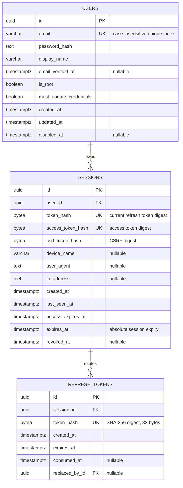

# Database schema

PostgreSQL is the system of record. SeaORM migrations are in `backend/migration/`. The dev API applies them at startup; production uses a one-shot migration service before the API starts.

## Entity relationship diagram



## Tables

### `users`

One account per normalized email address. A unique index on `LOWER(email)` prevents case variants from creating duplicates. Normalize email consistently in application code. `password_hash` stores an Argon2id password hash, never plaintext. Update `updated_at` when a user's profile changes.

`is_root` marks the first system account. `must_update_credentials` limits the seeded root account to login, logout, and updating its profile until it replaces its temporary email and password. `disabled_at` disables an account without deleting its history; authentication rejects disabled users.

### `sessions`

One row represents a device login. Multiple rows per `user_id` are allowed, so a user can sign in on multiple devices and revoke each one independently. `access_token_hash` stores the digest of the active opaque access token. Access tokens expire after 15 minutes and are checked against Postgres on each authenticated request, so logout and revocation apply immediately.

`token_hash` stores the current refresh token digest. `expires_at` is the absolute 30-day session expiry. `last_seen_at` is updated on refresh. Set `revoked_at` to invalidate a device session; deleting a user cascades to all sessions. `device_name`, `user_agent`, and `ip_address` are informational, not reliable device identity. Retain and expose them with appropriate privacy limits.

The session-bound CSRF token digest is stored in `csrf_token_hash`. Production browser cookies use `__Host-`, `Secure`, `HttpOnly` for auth tokens, and `SameSite=Lax`; state-changing requests must echo the CSRF token in `X-CSRF-Token`.

### `refresh_tokens`

Each row is one refresh token in a session family. A successful refresh consumes the presented token and inserts a replacement. The full hash history remains so presenting an already consumed token can be detected and the device session revoked. `replaced_by_id` records the rotation chain. Rotation does not extend the session's absolute expiry; retain history through the session expiry for replay detection.

## Authentication and authorization

The browser uses short-lived opaque access tokens plus rotating, single-use refresh tokens. This provides immediate server-side revocation and replay detection without storing bearer tokens in browser local storage. Password hashing uses Argon2id. For board features, add workspace or board membership records and check a user's role and access to the specific resource on every request; authentication alone must not grant access to every board.

## Migration operations

```sh
make migrate
make migrate-status
make migrate-down
```

Production migration commands are `make migrate-prod` and `make migrate-prod-status` with `POSTGRES_PASSWORD` set. The initial migration is `m202610130001_create_users_and_sessions`; `m202610130002_add_auth_token_rotation` adds bootstrap flags, token fields, CSRF binding, and refresh history. Rollbacks drop tables or auth state; only use them when the associated data loss is intended.
