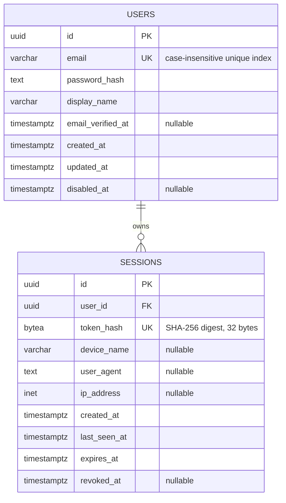

# Database schema

PostgreSQL is the system of record. SeaORM migrations are in `backend/migration/` and are applied by the API when it starts.

## Entity relationship diagram



## Tables

### `users`

One account per normalized email address. The unique index on `LOWER(email)` prevents case variants from creating duplicate accounts. Normalize email consistently in the application when registering or looking up a user. `password_hash` is reserved for an adaptive password hash such as Argon2id; never store a plaintext password. The application should update `updated_at` when changing a user's data.

`disabled_at` allows an account to be disabled without deleting its audit history. Authentication should reject disabled users and revoke their active sessions.

### `sessions`

Each successful login creates a row. Multiple rows per `user_id` are allowed, so a user can stay signed in on multiple devices and revoke each session independently. The browser receives a cryptographically random, high-entropy opaque token; only its SHA-256 digest is stored in `token_hash`. The raw token must not be logged or persisted in the database.

`expires_at` is the absolute expiry. `last_seen_at` supports an idle timeout if the application chooses one. Set `revoked_at` to invalidate one session; delete the user to cascade-delete all of their sessions. `device_name`, `user_agent`, and `ip_address` are informational and should not be treated as reliable device identity. Retain and expose them with appropriate privacy limits.

For browser authentication, use an opaque, cryptographically random session token in an `HttpOnly`, `Secure`, `SameSite=Lax` cookie and store only its SHA-256 digest here. Add CSRF protection for state-changing requests. The table deliberately allows many sessions for one user and supports revoking each device session independently.

For account passwords, use Argon2id with a unique salt and a cost that is benchmarked for the deployment environment. Keep authorization separate from authentication: add workspace or board membership records and check the authenticated user's role and access to the specific requested resource on every operation.

## Migration operations

Pending migrations are applied on API startup. For local CLI use, set `DATABASE_URL` and run from the repository root:

```sh
cargo run --manifest-path backend/migration/Cargo.toml -- status
cargo run --manifest-path backend/migration/Cargo.toml -- up
```

The initial migration is `m202610130001_create_users_and_sessions`. Its `down` operation drops both tables and therefore deletes account and session data; use rollback commands only when that data loss is intended.
